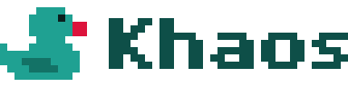

<div class="khaos-hero">
  
  
  <h1>Khaos</h1>
  <p class="khaos-tagline">A modern, fast and flexible <strong>.NET game framework</strong> for <strong>Windows</strong>, <strong>Linux</strong> and <strong>the browser</strong>, from the same C#.</p>
  <div class="khaos-badges">
    <span class="quack-badge quack-badge-primary">.NET 11</span>
    <span class="quack-badge quack-badge-accent">2D</span>
    <span class="quack-badge">3D coming</span>
    <span class="quack-badge">Windows · Linux · WebAssembly</span>
    <span class="quack-badge">MIT</span>
  </div>
  <div class="khaos-actions">
    <a class="quack-btn quack-btn-primary quack-btn-lg" href="guides/getting-started.md"><i class="bi bi-play-fill"></i> Get started</a>
    <a class="quack-btn quack-btn-secondary quack-btn-lg" href="guides/installation.md"><i class="bi bi-download"></i> Installation</a>
    <a class="quack-btn quack-btn-ghost quack-btn-lg" href="https://github.com/kappaduck/khaos"><i class="bi bi-github"></i> GitHub</a>
  </div>
</div>

<div class="khaos-quickstart">

```bash
dotnet new install KappaDuck.Khaos.Templates
dotnet new khaos -o MyGame
dotnet run --project MyGame/MyGame.Desktop   # or MyGame.Web
```

</div>

<h2 class="khaos-section-title">Start here</h2>

<div class="khaos-grid">
  <a class="quack-card" href="guides/introduction.md"><div class="quack-card-body">
    <h3><i class="bi bi-stars"></i> New to making games</h3>
    <p>What Khaos is, what a game loop is, and your first window in a few minutes. No game development experience needed.</p>
  </div></a>
  <a class="quack-card" href="guides/game-jam.md"><div class="quack-card-body">
    <h3><i class="bi bi-stopwatch"></i> Jamming this weekend</h3>
    <p>The short path: set up before the jam, make the game, and upload a zip to the game jam before the deadline.</p>
  </div></a>
  <a class="quack-card" href="guides/coming-from.md"><div class="quack-card-body">
    <h3><i class="bi bi-arrow-left-right"></i> Coming from another engine</h3>
    <p>Unity, Godot, MonoGame or raylib: where the things you know live in Khaos, and what works differently.</p>
  </div></a>
</div>

<h2 class="khaos-section-title">Why Khaos</h2>

<div class="khaos-grid">
  <div class="quack-card"><div class="quack-card-body">
    <h3><i class="bi bi-code-slash"></i> Modern C#</h3>
    <p>Your game is a C# class on .NET 11, written with the latest C#. No editor to learn, no scene files: open your IDE and write the game.</p>
  </div></div>
  <div class="quack-card"><div class="quack-card-body">
    <h3><i class="bi bi-globe2"></i> One game, every platform</h3>
    <p>The same code runs on Windows, on Linux and in the browser. Players on the web need nothing installed.</p>
  </div></div>
  <div class="quack-card"><div class="quack-card-body">
    <h3><i class="bi bi-lightning-charge"></i> Fast and light</h3>
    <p>A desktop game is a single executable with no .NET to install, and the engine keeps the garbage collector out of your frames.</p>
  </div></div>
  <div class="quack-card"><div class="quack-card-body">
    <h3><i class="bi bi-arrow-repeat"></i> Smooth on any machine</h3>
    <p>Gameplay runs at a fixed rate and drawing follows the screen, so the game feels the same on a fast PC and in a slow browser tab.</p>
  </div></div>
  <div class="quack-card"><div class="quack-card-body">
    <h3><i class="bi bi-boxes"></i> The .NET you already know</h3>
    <p>Dependency injection, logging and <code>appsettings.json</code>, like any .NET app, on every platform.</p>
  </div></div>
  <div class="quack-card"><div class="quack-card-body">
    <h3><i class="bi bi-trophy"></i> Made for game jams</h3>
    <p>One command gives a zip ready to upload to your jam, with a loading screen and a Play button already there.</p>
  </div></div>
</div>

<h2 class="khaos-section-title">Explore</h2>

<div class="khaos-grid">
  <a class="quack-card" href="guides/getting-started.md"><div class="quack-card-body">
    <h3><i class="bi bi-book"></i> Guides</h3>
    <p>From an empty folder to a game people can play: installation, your first game, settings, assets, publishing.</p>
  </div></a>
  <a class="quack-card" href="examples/readme.md"><div class="quack-card-body">
    <h3><i class="bi bi-grid-3x3-gap"></i> Examples</h3>
    <p>One idea per example, running right on the page, with all of its code below it to read and copy.</p>
  </div></a>
  <a class="quack-card" href="../demo/readme.md"><div class="quack-card-body">
    <h3><i class="bi bi-controller"></i> Demos</h3>
    <p>Complete games made with Khaos, from Breakout to a jam game, playable in your browser.</p>
  </div></a>
  <a class="quack-card" href="api/index.md"><div class="quack-card-body">
    <h3><i class="bi bi-braces"></i> API reference</h3>
    <p>Every class and method you can use in a game, with what it does and how to call it.</p>
  </div></a>
  <a class="quack-card" href="rules/readme.md"><div class="quack-card-body">
    <h3><i class="bi bi-shield-check"></i> Errors and warnings</h3>
    <p>A <code>KHAOS</code> message in your build? What it means and how to fix it.</p>
  </div></a>
  <a class="quack-card" href="guides/roadmap.md"><div class="quack-card-body">
    <h3><i class="bi bi-signpost-split"></i> Roadmap</h3>
    <p>What each version brings, on the way to Ludum Dare in April 2027, and what comes after.</p>
  </div></a>
</div>

<div class="khaos-status">

> [!NOTE]
> Khaos is young and still moving fast: names can change from one version to the next until 1.0. It makes 2D games
> today, and 3D comes after April 2027. The [roadmap](guides/roadmap.md) says what each version brings.

</div>
