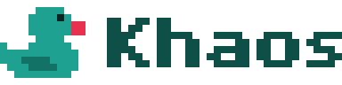

<p align="center">
  <picture>
    <source media="(prefers-color-scheme: dark)" srcset="https://raw.githubusercontent.com/kappaduck/khaos/main/assets/github/khaos-lockup-dark.svg">
    <source media="(prefers-color-scheme: light)" srcset="https://raw.githubusercontent.com/kappaduck/khaos/main/assets/github/khaos-lockup-light.svg">
    
  </picture>
</p>

<p align="center">Make chaos. Khaos keeps the order.</p>

<p align="center">
  
  <a href="https://www.nuget.org/packages/KappaDuck.Khaos/"></a>
</p>

## Overview

Khaos is a .NET 11 game framework built on SDL3 and its extensions ([SDL_image], [SDL_mixer], [SDL_ttf]).

It wraps SDL in a clean, idiomatic C# API, and takes care of the window, the loop and the platform. `Game2D` draws
with [SDL_Renderer].

## Why Khaos

Your game can be chaos, with enemies everywhere and explosions on every side. Khaos keeps the order under it.

- **Your game is a .NET app.** It is plain C#, with no pointers, no native handles and no C-style calls. Dependency
  injection, logging and configuration come from `Microsoft.Extensions`, so what you know from ASP.NET Core works here.
- **The compiler is on your team.** `Event` is a source-generated union, so `OnEvent` pattern-matches on cases like
  `KeyPressed` without boxing or allocating, and a game declares its own events with `[CustomEvents]`. Input actions
  name what the player does (`Jump`, `Move`) and bind it to keys, mouse buttons and gamepads. [Analyzers][rules]
  report a mistake while you type, and each rule has a page that explains why.
- **Every frame counts.** The framework avoids allocating on every frame, so the garbage collector stays out of the
  way, and a project of allocation tests checks it. The simulation runs on a fixed step, drawing smooths the motion
  between two steps, and the [performance](https://khaos.kappaduck.com/performance/) is measured on every release.
- **One game, every platform.** `dotnet new khaos` sets up the game with a desktop and a web application. The
  `assets/` folder goes along, so the game loads a file by the same path on Windows, Linux and in the browser.

## Usage

```csharp
// Pong/PongGame.cs: the game, a library shared by the desktop and web applications
namespace Pong;

public sealed class PongGame() : Game2D("Pong!", 1280, 720)
{
    private Sprite _ball = null!;
    private Point _previous = new(640f, 360f);
    private Point _position = new(640f, 360f);
    private Vector2 _velocity = new(240f, 180f);

    protected override void Initialize() => _ball = new Sprite(Assets.LoadTexture("assets/sprites/ball.png"));

    protected override void OnEvent(in Event e)
    {
        if (e is KeyPressed { Code: Scancode.Escape })
            Exit();
    }

    protected override void FixedUpdate(in GameTime time)
    {
        _previous = _position;
        _position += _velocity * time.Delta;
    }

    protected override void Update(in GameTime time)
    {
        // Cosmetic only, so it follows the real clock and stays smooth whatever the simulation rate.
        _ball.Rotation += Angle.FromDegrees(180f * time.Delta);
    }

    protected override void Draw(Renderer renderer, in Frame frame)
    {
        _ball.Position = Point.Lerp(_previous, _position, frame.Alpha);

        renderer.Clear(Color.Teal);
        renderer.Draw(_ball);
    }
}
```

```csharp
// Pong.Desktop/Program.cs: configure any settings, then run the game. Pong.Web has its own too.
using Pong;

return KhaosApplication.CreateBuilder(args)
                       .Build<PongGame>()
                       .Run();
```

`FixedUpdate` runs on the simulation clock and `Update` on the real one. `Draw` gets neither: `frame.Alpha` is
how far the frame sits between two simulation steps, so the ball is drawn between its last two positions instead of
jumping from one to the next. The renderer is handed to `Draw` and nowhere else, so nothing can draw outside of it.

More samples and documentation can be found at [Documentation](#documentation).

> [!NOTE]
> The public API is still a prototype. Expect frequent changes.

## Installation

### With the template

The quickest start is the template. By default it sets up the game and two applications that run it, one for the
desktop and one for the browser. `--platform` makes a single project for one of them instead:

```bash
dotnet new install KappaDuck.Khaos.Templates

dotnet new khaos -o Pong                       # the game, a desktop and a web application
dotnet new khaos -o Pong --platform desktop    # one project for Windows and Linux
dotnet new khaos -o Pong --platform browser    # one project for the browser, made for game jams
```

The template keeps the Khaos version in one place, `Directory.Packages.props`.

### Without the template

Every project references one package from [NuGet], `KappaDuck.Khaos`. It brings SDL for every platform and sees
what the project is: a `Microsoft.NET.Sdk` executable runs on Windows and Linux, a `Microsoft.NET.Sdk.WebAssembly`
one runs in the browser.

```bash
dotnet package add KappaDuck.Khaos -v 0.1.0
```

or via your `.csproj`, on the desktop:

```xml
<Project Sdk="Microsoft.NET.Sdk">
  <PropertyGroup>
    <TargetFramework>net11.0</TargetFramework>
    <OutputType>Exe</OutputType>
  </PropertyGroup>

  <ItemGroup>
    <PackageReference Include="KappaDuck.Khaos" Version="0.1.0" />
  </ItemGroup>
</Project>
```

In the browser, the project uses the WebAssembly SDK and needs the `wasm-tools` workload
(`dotnet workload install wasm-tools`):

```xml
<Project Sdk="Microsoft.NET.Sdk.WebAssembly">
  <PropertyGroup>
    <TargetFramework>net11.0</TargetFramework>
    <OutputType>Exe</OutputType>
  </PropertyGroup>

  <ItemGroup>
    <PackageReference Include="KappaDuck.Khaos" Version="0.1.0" />
  </ItemGroup>
</Project>
```

For both from the same code, put the game in a library that references `KappaDuck.Khaos`, then add one executable
per platform, as above, that references the library instead of the package.

You can also install via the NuGet Package Manager in Visual Studio or JetBrains Rider.

> [!WARNING]
> Khaos is still in early development. Expect breaking changes and frequent updates. Always use the latest version for the best experience.

### Beta packages

Pre-release versions are published to NuGet.org alongside stable releases. To install the latest beta:

```bash
dotnet package add KappaDuck.Khaos --prerelease
```

## Packages

| Package                     | What it brings                                                                                              |
| :-------------------------- | :---------------------------------------------------------------------------------------------------------- |
| `KappaDuck.Khaos`           | The framework: game loop, windowing, input, 2D rendering, assets, hosting, analyzers, the WebAssembly build |
| `KappaDuck.Khaos.Native`    | SDL3 for Windows, Linux and WebAssembly, referenced by `KappaDuck.Khaos`                                    |
| `KappaDuck.Khaos.Templates` | `dotnet new khaos`: a game with its desktop and web applications                                            |

## Roadmap

The first goal is a 2D game made with Khaos that runs on desktop and in the browser by March 31, 2027, ready for
[Ludum Dare] in April 2027. Each milestone ends with a release on NuGet that runs on Windows, Linux and in the browser.

| Version | Target          | What it brings                                                                                                                                                                                                 |
| :-----: | :-------------- | :------------------------------------------------------------------------------------------------------------------------------------------------------------------------------------------------------------- |
| `0.1.0` | Late Dec. 2026  | The foundations: `Game2D` on SDL's main callbacks with a fixed step, events, window, hosting, the template, batched 2D renderer, shapes, textures, sprites, letterbox, keyboard, mouse, gamepad, input actions |
| `0.2.0` | Mid Jan. 2027   | A game from start to finish: audio with buses, text, the asset catalog for images, sounds and fonts, async loading, scenes and transitions, a first debug overlay                                              |
| `0.3.0` | Early Feb. 2027 | The 2D world: 2D camera, sprite sheets and animations, collisions, tilemaps, timers and tweens                                                                                                                 |
| `0.4.0` | Late Feb. 2027  | Jam comfort: splash and loading screens, the full debug overlay, particles, simple UI, render targets                                                                                                          |
| `0.5.0` | Mar. 31, 2027   | The jam release: fixes only, then the engine freezes                                                                                                                                                           |

Scenes, cameras, tilemaps, collisions and tweens will ship in a separate `KappaDuck.Khaos.Toolkit` package.

After the jam: `Game3D` on [SDL_GPU], .NET 12, 2D shader effects, Android, rebindable controls saved between
launches, networking and more. 1.0.0 follows at the end of 2027 on .NET 12 alone, with a stable API until 2.0,
complete 2D and a first `Game3D` on Windows, Linux and the browser. Dates and scope can move, the jam comes first.

## Documentation

Full API documentation and samples are available:

- [Full API reference][khaos.kappaduck.com]
- [Performance](https://khaos.kappaduck.com/performance/): how fast Khaos is, measured on every release
- **[Examples][examples]**: one concept per example, playable in the documentation
- **[`demo/`][demo]**: games made with Khaos, from small ones that each show a few features to a full game, playable in the documentation

> [!NOTE]
> The documentation is a work in progress.

## Cross-platform support

Khaos supports Windows, Linux and the browser thanks to SDL3's abstraction layer and .NET on WebAssembly.

A game uses the same API on all three. Where a platform differs underneath, Khaos handles it, and the guides say when a
game can see the difference: in the browser, for example, the game always has a single screen.

## SDL compatibility

SDL3 native libraries are bundled via `KappaDuck.Khaos.Native`, on the desktop and in the browser. The table below shows
the SDL versions included in each release of the package.
The `source` row tracks the main branch and every other row lists the native version that Khaos release depends on.

|  Khaos   | Native  |   SDL3   | SDL_image | SDL_ttf | SDL_mixer |
| :------: | :-----: | :------: | :-------: | :-----: | :-------: |
| `source` | `1.2.1` | `3.4.20` |  `3.4.8`  | `3.2.2` |  `3.2.4`  |

## Development & Sandbox

You can build Khaos from source and experiment quickly using the included sandbox project.

### Prerequisites

- [.NET 11.0 SDK](https://dotnet.microsoft.com/download/dotnet/11.0)
- For the browser: the `wasm-tools` workload (see [In the browser](#in-the-browser))

### Setup

#### **1. Clone the repository**

```bash
git clone https://github.com/KappaDuck/khaos.git
cd khaos
```

On Windows, some test files have long paths: clone into a short folder (`C:\dev\khaos`), or turn on long paths in Git
first with `git config --global core.longpaths true`.

#### **2. Build and test**

```bash
dotnet build khaos.slnx
dotnet test --solution tests.slnf
```

### Sandbox

`sandbox/` is for experimenting without touching the main source. Its code is compiled by both apps, desktop and browser, which use `src/` by path the way a game uses the packages, so changes are reflected immediately.

Your code (any `.cs` file in `sandbox/`, subfolders included) and your assets (`sandbox/assets/`) are ignored by git.
If the folder holds no source at all, the first build drops a starter `Program.cs` in from `Program.cs.template`, so a
fresh clone always compiles.

```bash
dotnet run --project sandbox/Desktop
```

or simply run it in your IDE.

#### In the browser

The browser app needs the `wasm-tools` workload, which links SDL into the .NET runtime as WebAssembly.

```bash
dotnet workload install wasm-tools
dotnet run --project sandbox/Web
```

or simply run it in your IDE.

`dotnet run` builds the app, starts a local server and prints its address (`App url: ...`): open it in your browser.
The first build takes longer, since it relinks the .NET runtime with SDL.

## AI disclosure

Khaos is written by hand. AI (Claude) is a tool here, not an author of the code:

- **Design**: it helps shape a public API from the side of the developer who will use it (the code a game
  writes, the cases to cover, how other engines solve it), in `docs/design/`.
- **Documentation**: it helps write the guides and the XML documentation of the public API.
- **Questions**: it answers questions about a bug or the performance, and shows its sources.

It writes no code of the framework: no C#, no tests, no build scripts, no CI. Everything it writes is
reviewed, and a commit with AI-written changes says so with a `Co-Authored-By` line. The rules it follows are
in `CLAUDE.md`.

## Credits

Built on

- [SDL3]
- [SDL_image]
- [SDL_ttf]
- [SDL_mixer]

Inspired by

- [SFML](https://www.sfml-dev.org/)
- [LazyFoo](https://lazyfoo.net/index.php)
- [Sayers.SDL2.Core](https://github.com/JeremySayers/Sayers.SDL2.Core)
- [SDL3-CS](https://github.com/flibitijibibo/SDL3-CS)
- [Godot](https://godotengine.org/)
- [Unity](https://unity.com/)
- [MonoGame](https://monogame.net/)
- [raylib](https://www.raylib.com/)

[examples]: https://khaos.kappaduck.com/examples/
[demo]: https://khaos.kappaduck.com/demo/
[NuGet]: https://www.nuget.org/packages/KappaDuck.Khaos/
[SDL3]: https://www.libsdl.org/
[SDL_image]: https://github.com/libsdl-org/SDL_image
[SDL_mixer]: https://github.com/libsdl-org/SDL_mixer
[SDL_ttf]: https://github.com/libsdl-org/SDL_ttf
[SDL_Renderer]: https://wiki.libsdl.org/SDL3/CategoryRender
[SDL_GPU]: https://wiki.libsdl.org/SDL3/CategoryGPU
[Ludum Dare]: https://ludumdare.com/
[khaos.kappaduck.com]: https://khaos.kappaduck.com
[rules]: https://khaos.kappaduck.com/rules/readme.html
